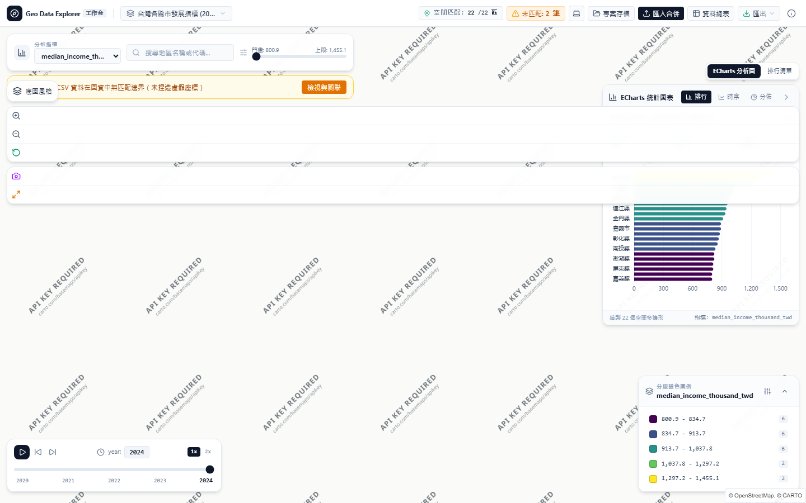

# Geo Data Explorer

[繁體中文](README.zh-TW.md) · **English**

> **Pure Frontend Geospatial Data Analysis & Choropleth Studio**, 100% in-browser sandbox computation with zero server data transfer.

<p align="center">
  
</p>

<p align="center">
  <a href="https://github.com/ReiKama414/geo-data-explorer">GitHub</a> ·
  <a href="https://reikama414.vercel.app/">Portfolio</a> ·
  <a href="#key-highlights">Highlights</a> ·
  <a href="#getting-started">Getting Started</a> ·
  <a href="#testing--validation">Validation</a> ·
  <a href="#license">License</a>
</p>

---

## Key Highlights

- **Pure In-Browser Sandbox Computation** — All GeoJSON topological rendering, CSV joins, statistical classification, and chart visualizations execute entirely in the client browser with zero server dependencies or network transmission.
- **Authentic Spatial Joins & Multi-Dimensional Discovery** — Automated detection of polygon identifiers, CSV matching keys, numerical metric columns, and multi-period time dimensions.
- **Strict Unmatched Data Protection** — For CSV records lacking corresponding polygon boundaries, **never fabricate or guess fake coordinates**, providing a dedicated diagnostic inspector, manual alias mapper, and unmatched CSV export.
- **Four Statistical Classification Methods** — Complete implementations of Jenks Natural Breaks, Quantile, Equal Interval, and Logarithmic algorithms, featuring 9 continuous color palettes and 3 to 8 classification bins.
- **ECharts Five-Tier Document Flow Architecture** — Engineered with an isolated five-tier document flow structure (Header, Description, Statistics, Chart, and Legend/Footer), delivering regional horizontal rankings, multi-period line trends, and distribution histograms.
- **Multi-Period Timeline Progression** — Smooth transition between discrete time periods (e.g. 2020-2024), auto-play, step navigation, and speed adjustments.
- **Responsive Design & Dual Theme** — Support for System, Light, and Dark modes across 9 distinct viewports (320px to 1920px), engineered with a strict Zero-Overlap Document Flow layout.
- **IndexedDB Offline Persistence** — Browser-native storage engine automatically persists datasets and session filters, enabling seamless continuation across browser restarts.

---

## Built-in Datasets

The studio comes preloaded with three spatial datasets covering administrative counties, sovereign world borders, and federal states, while supporting custom GeoJSON and CSV drag-and-drop ingestion:

| Dataset Name | Dimensions | Key Attributes | Analytical Focus |
| :--- | :--- | :--- | :--- |
| Taiwan County Development Metrics | 22 counties · 5 periods · 7 cols | Population, Median Income, Ageing Index, Solar Power, Housing Price | Urban-rural income disparities, aging trends, and isolated unmatched test records |
| Global Sovereign Indicators | 177 countries · 5 periods · 6 cols | GDP per capita, Life Expectancy, Renewable Energy %, Internet % | Highly skewed wealth distribution with logarithmic scaling, green energy transition |
| US States Economic & Clean Energy | 52 states/territories · 4 periods · 5 cols | Median Household Income, EV Adoption %, Clean Energy % | Clean energy vehicle adoption distribution, regional development divergence |

---

## Mathematical Precision & Spatial Join Guarantees

Every analytical algorithm and spatial join mechanism is verified via independent unit tests (100% pass rate) to guarantee mathematical consistency with vector boundaries:

- **Jenks Natural Breaks Classification**: Minimizes the Sum of Squared Deviations from the Class Mean ($SDAM$) while maximizing between-class variance to achieve optimal Goodness of Variance Fit ($GVF$):
  $$GVF = 1 - \frac{SDAM}{SDCM} = 1 - \frac{\sum_{j=1}^{k} \sum_{i=1}^{n_j} (x_{ij} - \bar{x}_j)^2}{\sum_{i=1}^{n} (x_i - \bar{x})^2}$$
- **Quantile Classification**: Implemented via the standard R-7 / NumPy linear quantile interpolation method, partitioning sorted records into $k$ bins with equal frequencies:
  $$p_j = \frac{j}{k}, \quad h = (n - 1)p_j + 1, \quad Q(p_j) = x_{\lfloor h \rfloor} + (h - \lfloor h \rfloor)(x_{\lfloor h \rfloor + 1} - x_{\lfloor h \rfloor})$$
- **Equal Interval Classification**: Divides the continuous domain range into $k$ equal-width segments:
  $$\Delta = \frac{x_{\max} - x_{\min}}{k}, \quad \text{Break}_j = x_{\min} + j \cdot \Delta \quad (j = 1, \dots, k)$$
- **Logarithmic Classification**: Applies offset logarithmic transformation to heavily skewed distributions prior to uniform partitioning, then maps back to the raw value domain:
  $$y_i = \ln(x_i - x_{\min} + 1), \quad \text{Break}_j = x_{\min} + \exp\left(j \cdot \frac{y_{\max}}{k}\right) - 1$$
- **Spatial Join Key Matching Rate**:
  $$\text{Match Rate} = \frac{|G \cap C|}{|C|} \times 100\%$$
- **Strict Zero Coordinate Fabrication**: For all unmatched records $c \in C \setminus G$, coordinates are strictly left empty. The system never generates fake points or randomly guessed coordinates:
  $$\forall c \notin G, \quad \text{Geometry}(c) = \emptyset$$

---

## Tech Stack

| Layer | Technology | Purpose |
| :--- | :--- | :--- |
| Frontend Framework | React 19 · TypeScript | Component modularity and strict type-safety guarantees |
| Build Tool | Vite | Ultra-fast local development server and optimized Rollup production bundling |
| Styling & Theme | Tailwind CSS 4 | High-density workbench aesthetic with unified dark/light design tokens |
| Map Engine | MapLibre GL JS | Vector polygon rendering, smooth choropleth shading, basemap switcher |
| Data Visualization | Apache ECharts 6 | Five-tier document flow charts: horizontal rankings, trend lines, histograms |
| Spatial Statistics | d3-scale · d3-array | Jenks natural breaks, Quantile, Equal, and Logarithmic algorithm implementations |
| Data Ingestion | PapaParse | High-performance RFC-4180 streaming CSV parser with UTF-8 BOM support |
| Local Persistence | Native IndexedDB | Multi-project persistence and workspace session restoration |
| UI Iconography | Lucide Icons | Minimal, pixel-crisp geometric vector icons |
| Automated Testing | Playwright · Vitest | Core statistical unit tests, 9-viewport RWD, theme switching, and zero-overlap tests |

---

## Getting Started

### Prerequisites

Node.js 20+ and npm.

### Installation & Development

```bash
# 1. Install dependencies
npm install

# 2. Start local development server
npm run dev
```

Open the printed local URL (default: `http://localhost:5173`) in your browser.

### Production Build & Preview

```bash
# Execute TypeScript checking and production bundle
npm run build

# Preview production build locally
npm run preview
```

---

## User Workflow

1. **Dataset Loading**: Click "匯入 / 切換圖資" in the header to select from 3 preloaded spatial datasets, drag-and-drop local GeoJSON/CSV files, or use the key mapping wizard.
2. **Metric & Value Filtering**: Use the top filter bar to switch analysis metrics, search region names or codes, or drag the numeric range threshold slider.
3. **Classification & Palette Configuration**: In the lower-right legend, switch between Jenks, Quantile, Equal, or Logarithmic classifications, pick from 9 palettes, and adjust class counts (3-8).
4. **Timeline Dynamic Progression**: For multi-period datasets, use the timeline player at the bottom left to play, pause, step through periods, or toggle 1x/2x playback speed.
5. **ECharts Analytical Insights**: Expand the right analytics panel to examine horizontal bar rankings, multi-period line trend trajectories, or class distribution histograms.
6. **Unmatched Diagnostics & Alias Remapping**: Click the unmatched alert banner to inspect unmapped CSV rows and use the manual alias mapper to pair keys with existing polygons.
7. **Unified Data Table & Search**: Click "資料總表" in the header to view joined attribute records and unmatched rows, sort by columns, or export CSV files.
8. **Project Saving & Snapshot Export**: Click "專案存檔" to persist the workspace to browser IndexedDB or export `.geodata.json` files; click the camera icon to export high-res PNG map snapshots.

---

## Testing & Validation

The project undergoes automated validation covering spatial algorithms and browser workflows (39 automated tests):

```bash
# Run calculation unit tests (Vitest)
npm test

# Run full Playwright browser suite
npm run test:e2e
```

Validation Checklist:

- **Mathematical Precision**: Jenks Natural Breaks, Quantile steps, Equal Interval, Logarithmic algorithms, and number formatting verified to 100% precision.
- **Data Integrity**: Identifier candidate detection, time extraction, strict unmatched isolation (never inventing fake coordinates), and manual alias mapping.
- **RWD Verification**: Zero horizontal page overflow verified across 320px, 375px, 390px, 430px, 768px, 1024px, 1280px, 1440px, and 1920px viewports.
- **Dual Theme Support**: System preference detection, light/dark mode toggling, and localStorage persistence across basemap and charts.
- **Zero-Overlap Architecture**: Non-intersecting bounding box verification between titles, filter bars, map controls, time slider, and legend under 100% and 200% zoom levels.

---

## Known Limitations

> **Note:**
> 1. All vector polygon rendering and spatial computations execute locally in the client browser. GeoJSON files under 50MB are recommended for optimal 60fps interaction.
> 2. Offline storage relies on the browser's IndexedDB storage quota. Incognito sessions will clear persisted datasets upon closing the window.
> 3. Uploaded CSVs should be UTF-8 encoded; please convert legacy Big5 CSVs before loading.

---

## License

Copyright (c) ReiKama414. All rights reserved.

This software and its source code are provided solely for personal viewing and learning purposes.
No permission is granted to use, copy, modify, distribute, sublicense, or incorporate this software
or any part of it into other projects, whether for commercial or non-commercial purposes,
without the express written consent of the copyright holder.

- [GitHub](https://github.com/ReiKama414/geo-data-explorer)
- [Portfolio](https://reikama414.vercel.app/)
- [Full License](./LICENSE)

---

<sub>Geo Data Explorer · Pure Frontend Geospatial Data Analysis & Choropleth Studio · ReiKama414</sub>
