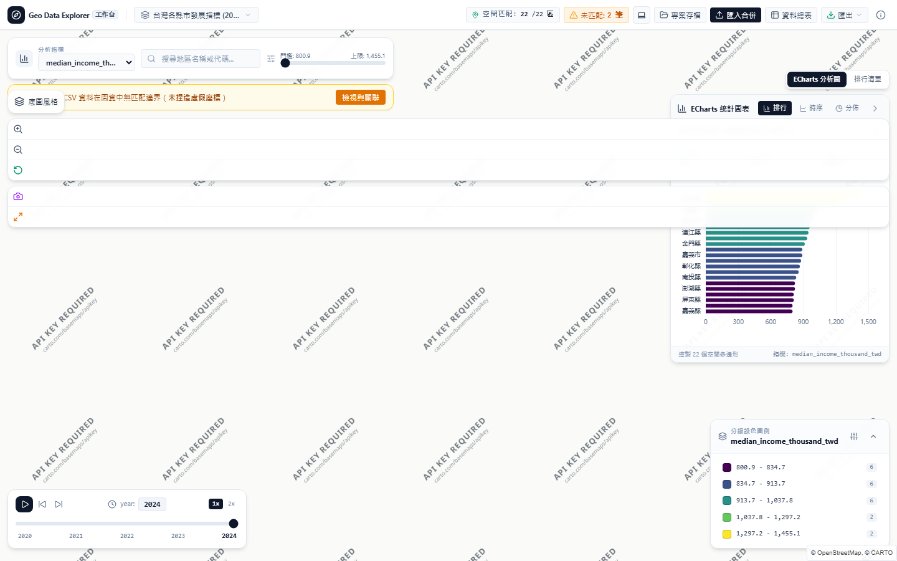

# Geo Data Explorer

**繁體中文** · [English](README.md)

> **純前端地理空間資料分析與分級設色工作台**，100% 瀏覽器本地沙盒運算，零伺服器資料傳輸

<p align="center">
  
</p>

<p align="center">
  <a href="https://github.com/ReiKama414/geo-data-explorer">GitHub</a> ·
  <a href="https://reikama414.vercel.app/">個人網站</a> ·
  <a href="#核心亮點">核心亮點</a> ·
  <a href="#快速開始">快速開始</a> ·
  <a href="#驗證與測試">驗證與測試</a> ·
  <a href="#license--權限">授權</a>
</p>

---

## 核心亮點

- **純瀏覽器本地沙盒運算** — 所有 GeoJSON 拓樸渲染、CSV 關聯匹配、統計分級演算與圖表繪製皆在使用者瀏覽器本地執行，完全零後端依賴與伺服器資料傳輸
- **真實空間關聯與多維探測** — 自動探測空間多邊形代碼與 CSV 鍵值，自動識別數值指標欄位與多期時間維度
- **嚴謹未匹配隔離防護** — 對於無對應多邊形的 CSV 記錄，**絕不捏造或隨意推測經緯度座標**，提供專屬診斷面板、手動別名映射與未匹配 CSV 匯出
- **四種專業統計分級演算** — 完整實作 Jenks 自然間斷法、分位數法、等距分級法與對數分級法，搭配九款專業漸層色盤與 3 至 8 階色階調整
- **ECharts 五階文檔流圖表** — 採嚴格五階獨立排版結構（標題、說明、統計數值、圖表繪製、圖例補充），提供各區橫向柱狀排行、多期時序走勢與分級分佈直方圖
- **多期時序動態推進** — 支援離散時間維度（如 2020-2024 年）平滑切換、自動步進播放、單步微調與播放倍速切換
- **全響應式與黑白雙主題** — 支援跟隨系統、淺色與深色三種模態，適配 320px 至 1920px 九種螢幕尺寸，全域採用無重疊（Zero-Overlap）獨立 Document Flow 排版架構
- **IndexedDB 離線持久化儲存** — 內建瀏覽器原生資料庫儲存，工作區自動暫存、命名專案儲存、專案清單還原載入與備份 JSON 匯出匯入

---

## 內建實戰資料集

系統預載三組涵蓋行政區、全球國界與聯邦州別之空間資料集，亦支援隨時拖曳匯入自訂 GeoJSON 與 CSV：

| 資料集名稱 | 規格 | 特徵屬性 | 探索重點 |
| :--- | :--- | :--- | :--- |
| 台灣各縣市發展指標 | 22 縣市 · 5 年期 · 7 欄 | 人口、所得中位數、老化指數、太陽能容量、平均房價 | 縣市城鄉所得與房價差距、高齡化偏鄉趨勢、特定保護區未匹配紀錄驗證 |
| 全球各國發展指標 | 177 國 · 5 年期 · 6 欄 | 人均 GDP、預期壽命、再生能源比例、網路普及率 | 極端所得高度偏態之對數分級、各洲再生能源轉型趨勢、主權國界拓樸 |
| 美國各州經濟與綠能 | 52 州/特區 · 4 年期 · 5 欄 | 家庭收入中位數、電動車新車佔比、潔淨綠能佔比 | 綠能車輛滲透率分佈、東西兩岸與中西部州別發展差異、時序成長走勢 |

---

## 空間幾何與統計演算保證

所有分級算法與空間關聯邏輯皆經過獨立單元測試驗證（100% 通過），確保各項分析結果與幾何邊界完全吻合：

- **Jenks 自然間斷演算法 (Jenks Natural Breaks)**：透過最小化組內平方差和 (SDAM) 並極大化組間差異，使資料分組獲得最佳變異擬合優度 ($GVF$)：
  $$GVF = 1 - \frac{SDAM}{SDCM} = 1 - \frac{\sum_{j=1}^{k} \sum_{i=1}^{n_j} (x_{ij} - \bar{x}_j)^2}{\sum_{i=1}^{n} (x_i - \bar{x})^2}$$
- **分位數分級法 (Quantile Classification)**：採用 R-7 / NumPy 階梯分位算法，將所有已匹配地區數值排序後均分至 $k$ 個區間，使每組樣本數量相等：
  $$p_j = \frac{j}{k}, \quad h = (n - 1)p_j + 1, \quad Q(p_j) = x_{\lfloor h \rfloor} + (h - \lfloor h \rfloor)(x_{\lfloor h \rfloor + 1} - x_{\lfloor h \rfloor})$$
- **等距分級法 (Equal Interval)**：將極值範圍平均分割為 $k$ 個等長數值區間：
  $$\Delta = \frac{x_{\max} - x_{\min}}{k}, \quad \text{Break}_j = x_{\min} + j \cdot \Delta \quad (j = 1, \dots, k)$$
- **對數分級法 (Logarithmic Classification)**：對具高度右偏態分布之指標先進行平移對數變換，再行等距劃分後反推回原數值域：
  $$y_i = \ln(x_i - x_{\min} + 1), \quad \text{Break}_j = x_{\min} + \exp\left(j \cdot \frac{y_{\max}}{k}\right) - 1$$
- **空間鍵值匹配度 (Spatial Join Key Matching Rate)**：
  $$\text{Match Rate} = \frac{|G \cap C|}{|C|} \times 100\%$$
- **嚴格未匹配隔離規範 (Zero Coordinate Fabrication)**：對於所有 $c \in C \setminus G$ 的未匹配紀錄，系統嚴格維持幾何空值，絕不在地圖上隨機或隨意生成假經緯度點位：
  $$\forall c \notin G, \quad \text{Geometry}(c) = \emptyset$$

---

## 技術棧

| 層級 | 技術選型 | 用途說明 |
| :--- | :--- | :--- |
| 前端框架 | React 19 · TypeScript | 高效元件化開發與嚴格型別安全檢查 |
| 建置工具 | Vite | 極速本機開發伺服器與 Rollup 生產打包 |
| 樣式管理 | Tailwind CSS 4 | 高資訊密度專業工作台風格與雙主題規範 |
| 地圖引擎 | MapLibre GL JS | 向量多邊形渲染、平滑分級設色、底圖切換與圖徵定位 |
| 圖表繪製 | Apache ECharts 6 | 五階文檔流架構之橫向柱狀、時序折線與分級直方圖 |
| 空間統計 | d3-scale · d3-array | Jenks 自然間斷法、分位數、等距與對數演算法實作 |
| 表格處理 | PapaParse | 瀏覽器端高效 CSV 解析、RFC 4180 規格與 UTF-8 BOM 支援 |
| 本地儲存 | 原生 IndexedDB | 多專案持久化儲存、工作階段自動暫存與備份還原 |
| 圖示字型 | Lucide Icons | 統一、精緻的幾何向量圖示 |
| 自動化測試 | Playwright · Vitest | 核心統計單元測試、全裝置 RWD、雙主題與零重疊排版驗收 |

---

## 快速開始

### 系統需求

需要 Node.js 20+ 與 npm

### 安裝與啟動

```bash
# 1. 安裝依賴
npm install

# 2. 啟動本機開發伺服器
npm run dev
```

啟動後於瀏覽器開啟提示之本機網址（預設為 `http://localhost:5173`）

### 生產建置與預覽

```bash
# 執行 TypeScript 型別檢查與生產打包
npm run build

# 本地預覽生產版本
npm run preview
```

---

## 操作流程

1. **載入或切換圖資資料集**：點擊頂部「匯入 / 切換圖資」，可載入 3 組實戰圖資（台灣、全球、美國）、拖曳匯入自訂 GeoJSON 與 CSV，或使用手動對應精靈
2. **多維指標與數值過濾**：使用頂部篩選列切換分析指標、即時鍵入文字搜尋地區名稱或代碼，並可滑動數值門檻滑桿過濾地圖邊界
3. **分級演算法與色盤配置**：在右下角圖例面板切換 Jenks 自然間斷、分位數、等距或對數分級，挑選 9 款專業漸層色盤並自訂 3 至 8 階色階
4. **時序動態推進探索**：針對多期年份資料，點擊左下角時序控制器進行播放、暫停、單步微調或切換 1x / 2x 倍速，觀察指標時空演變
5. **ECharts 深度統計分析**：展開右側圖表面板，檢視各區橫向排序柱狀圖、多期時間序列趨勢折線圖，或各階層之地區數量分佈直方圖
6. **未匹配紀錄診斷與別名關聯**：點擊頂部未匹配警示橫幅，檢視未匹配 CSV 清單與列號，並可利用手動別名映射器建立代碼關聯
7. **全資料總表與條件檢索**：點擊頂部「資料總表」，瀏覽合併後屬性表格與未匹配 CSV 原始資料，支援排序並可個別匯出 CSV
8. **成果與專案存檔**：點擊「專案存檔」將當前工作區狀態存入 IndexedDB 或匯出 `.geodata.json` 備份檔；地圖工具列亦支援匯出高解析度 PNG 截圖

---

## 驗證與測試

本專案經過嚴格空間統計精準度與自動化瀏覽器驗收（共 39 項自動化測試）：

```bash
# 執行核心計算單元測試 (Vitest)
npm test

# 執行全套 Playwright 瀏覽器測試
npm run test:e2e
```

測試驗證清單：

- **統計精度**：Jenks 自然間斷法、分位數階梯、等距與對數演算法、數值格式化 100% 通過
- **資料完整性**：候選代碼自動偵測、時序提取、未匹配紀錄嚴格隔離（絕不捏造座標）、手動別名映射
- **全裝置 RWD**：驗證 320px、375px、390px、430px、768px、1024px、1280px、1440px、1920px 九種解析度，全域零水平溢出
- **黑白雙主題**：跟隨系統偏好、淺色模式與深色模式之即時切換與持久化，適配底圖與圖表畫布
- **Zero-Overlap 排版完整性**：Header、浮動篩選列、地圖控制按鈕、時間軸與圖例邊界不相交驗收，支援瀏覽器 200% 縮放

---

## 已知限制

> **提醒：**
> 1. 所有向量多邊形渲染與統計計算皆於使用者瀏覽器本地執行，建議單次匯入 GeoJSON 檔案大小控制在 50MB 以內，以維持最流暢之 60fps 縮放互動體驗
> 2. 本地資料持久化依賴瀏覽器 IndexedDB 儲存配額；若於無痕視窗（Incognito）操作，關閉瀏覽器後儲存內容將自動抹除
> 3. 匯入之 CSV 建議使用 UTF-8 編碼，若為舊版 Excel 匯出之 Big5 編碼請先轉存為 UTF-8

---

## License / 權限

Copyright (c) ReiKama414. All rights reserved.

本專案僅供個人瀏覽與學習。未經著作權人書面同意，不得使用、複製、修改、散布或併入其他專案（含非商業用途）

- [GitHub](https://github.com/ReiKama414/geo-data-explorer)
- [個人網站](https://reikama414.vercel.app/)
- [授權全文](./LICENSE)

---

<sub>Geo Data Explorer · 純前端地理空間資料分析與分級設色工作台 · ReiKama414</sub>
